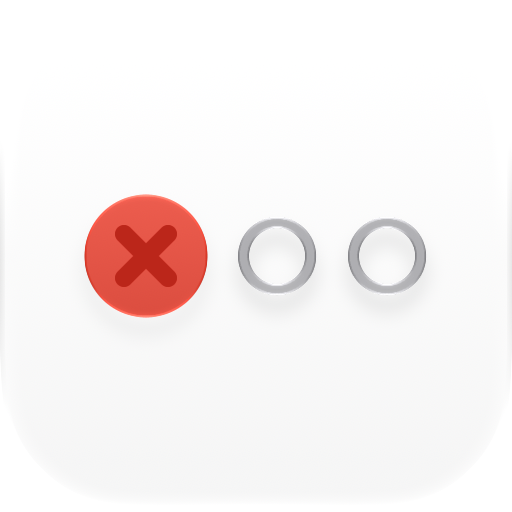

  <picture>
    <source media="(prefers-color-scheme: dark)" srcset="Bilder/icon-dunkel.png">
    
  </picture>

<h1 align="center">Queet</h1>

  Queet beendet eine App, sobald du ihr letztes Fenster schließt. 
  Fenster zu, Programm zu.

  <a href="https://github.com/zzuuuiii/Queet/releases/latest/download/Queet.dmg"><b>Queet herunterladen</b></a> (DMG, macOS 14 oder neuer)

## Was Queet anders macht

- Minimierte Fenster und Fenster auf anderen Schreibtischen oder im Vollbild halten die App offen. Was du noch brauchst, bleibt da.
- Startet eine App gerade oder kommt ein Öffnen-Dialog, wartet Queet etwas länger. Apps, die beim Laden ihr Fenster wechseln, werden nicht aus Versehen beendet.
- Auch Apps, die sich beim Schließen nur verstecken, werden beendet.
- Menüleisten-Apps und Hintergrundprogramme fasst Queet nie an. Der Finder bleibt immer offen.
- Kein Datenversand, kein Konto, keine Werbung. Queet nutzt nur offizielle Schnittstellen von macOS und braucht kaum Speicher.

## Installieren

1. `Queet.dmg` laden und Queet in den Ordner „Programme“ ziehen.
2. Queet öffnen. Weil Queet nicht bei Apple beglaubigt ist, blockiert macOS das erste Öffnen. Dann unter Systemeinstellungen > Datenschutz & Sicherheit auf „Trotzdem öffnen“ klicken.
3. Queet unter Bedienungshilfen erlauben. Nur so sieht Queet, wann ein Fenster zugeht.

Danach startet Queet bei jeder Anmeldung von selbst und läuft unsichtbar. Öffnest du Queet noch einmal, kommen die Einstellungen: ein- und ausschalten, Wartezeit und Apps, die nie beendet werden sollen.

## Lizenz

GPL-3.0. Selbst bauen geht mit `./bauen.sh` (braucht Xcode).
